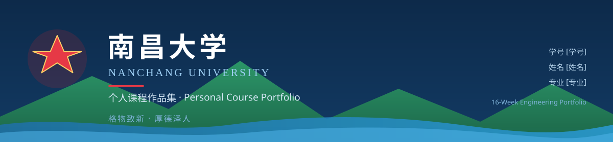

<!-- Banner：自绘的南昌大学标识横幅（红五星 · 赣江水纹 · 翠绿山体） -->
<p align="center">
  
</p>

<p align="center">
  
  
  
  
</p>

# 🎓 南昌大学 · 个人课程作品集

|  |  |
|---|---|
| 🏫 **学校** | 南昌大学（Nanchang University · NCU） |
| 🆔 **学号** | `[学号]` |
| 🧑 **姓名** | `[姓名]` |
| 📚 **专业** | `[专业]` |
| 📅 **学期** | 2026 秋季 · 共 16 周 |
| 🌐 **仓库** | `https://github.com/chencym178/ncu-portfolio` |

> ⚠️ **待办**：请把上表中三处 `[学号]` / `[姓名]` / `[专业]` 替换为你的真实信息；`assets/ncu-banner.svg` 横幅右下角也有同样的三处占位符。

本仓库用于系统化沉淀本学期（16 周）的课程实验与项目作品，是你面向未来招聘、保研夏令营、跨学科协作的 **个人作品集（Portfolio）** 起点。

> 📌 第一次使用？先阅读 [`UPLOAD-VIA-WEB.md`](./UPLOAD-VIA-WEB.md)（**零安装**，5 分钟把仓库传到 GitHub），弄懂术语看 [`docs/TERM-GLOSSARY.md`](./docs/TERM-GLOSSARY.md)。

---

## 🏛️ 关于南昌大学（Nanchang University · NCU）

南昌大学是国家"双一流"建设高校，办学始于 1940 年，扎根红土地，是江西省唯一的 **国家"211 工程"** 重点建设大学。

- 校训：**格物致新，厚德泽人**
- 校徽元素：红五星 + 蓝色水纹 + 翠绿色山体 + 赣江滔滔水系
- 精神内核：**实事求是、敢为人先**

> "格物致新"——探索事物规律，求得新知；"厚德泽人"——以深厚品德泽被他人。本作品集也希望体现这种"探索 + 利他"的精神。

---

## 📂 仓库目录树（16 周实验）

本作品集按照教学进度组织，每周一个独立目录，配有独立的 `README.md` 用于记录实验心得。

```
ncu-portfolio/
├── README.md                       你正在看的文件（仓库门面）
├── .gitignore                      Git 忽略规则清单（被忽略的文件不会进仓库）
├── UPLOAD-VIA-WEB.md               ⭐ 零安装上传指南（不想装 Git 看这篇）
├── auto-upload.ps1                 Git Data API 全自动建仓 + 首个 Commit（需 Token）
├── MANUAL_PUSH.md                  远程仓库创建 & 推送手册（命令行版）
├── setup.ps1                       一键自动化脚本（需先装 Git）
├── .secrets/                       🔒 存放 gh_token.txt（已被 .gitignore 永久排除，不会上传）
│
├── docs/
│   ├── TERM-GLOSSARY.md            术语大白话字典（.gitignore / Commit / Branch…）
│   ├── GITHUB-SETUP-GUIDE.md       GitHub 注册 & 创建公开仓库指引
│   └── LEARNING-RUBRIC.md          学习评估 / 评分维度（个人复盘）
│
├── assets/                         图片、截图、证书等静态资源
│   ├── README.md                   资源目录说明
│   └── ncu-banner.svg              🏫 南昌大学标识横幅（README 顶部引用）
│
└── weeks/                          16 周实验与项目
    ├── week-01-environment-setup/      Week 01 · 开发环境搭建（Git / Python / VS Code）
    ├── week-02-data-types-variables/   Week 02 · 基本数据类型与变量
    ├── week-03-operators-expressions/  Week 03 · 运算符与表达式
    ├── week-04-conditional-branching/  Week 04 · 条件分支（if/elif/else）
    ├── week-05-loop-structures/        Week 05 · 循环结构（for/while）
    ├── week-06-list-tuple/             Week 06 · 列表与元组
    ├── week-07-dict-set/               Week 07 · 字典与集合
    ├── week-08-functions-basics/       Week 08 · 函数基础（定义 / 参数 / 返回值）
    ├── week-09-module-package/         Week 09 · 模块与包（import / 自定义模块）
    ├── week-10-file-io/                Week 10 · 文件操作（读 / 写 / JSON / CSV）
    ├── week-11-exception-handling/     Week 11 · 异常处理（try/except/finally）
    ├── week-12-oop-classes/            Week 12 · 面向对象：类与对象
    ├── week-13-oop-inheritance/        Week 13 · 面向对象：继承与多态
    ├── week-14-data-structures/        Week 14 · 数据结构基础（栈 / 队列 / 链表）
    ├── week-15-algorithms-basics/      Week 15 · 算法基础（排序 / 查找 / 复杂度）
    └── week-16-final-project/          Week 16 · 综合项目展示（结课成果）
```

每个 `weeks/week-XX-xxx/` 子目录建议结构：
```
week-XX-xxx/
├── README.md        本周实验报告（目标 / 思路 / 关键代码 / 复盘）
├── main.py (或 .ipynb)
├── notes.md         学习笔记与踩坑记录
└── screenshots/     运行截图
```

---

## 🚀 快速开始

### 步骤 1 · 把它传到 GitHub（两条路，任选其一）

| 路线 | 适合谁 | 耗时 | 看这篇 |
|---|---|---|---|
| 🅰️ **零安装网页上传** | 不想装任何软件 | 5 分钟 | [`UPLOAD-VIA-WEB.md`](./UPLOAD-VIA-WEB.md) ⭐ 推荐 |
| 🅱️ **命令行 Git** | 想学完整工作流 | 10 分钟 | [`MANUAL_PUSH.md`](./MANUAL_PUSH.md) |

### 步骤 2 · 后续每周怎么提作业
在对应 `weeks/week-XX-xxx/` 写完代码与笔记后：
```bash
git add .
git commit -m "week-XX: <本次实验主题>"
git push
```

### 步骤 3 · 遇到不懂的术语
参见 [`docs/TERM-GLOSSARY.md`](./docs/TERM-GLOSSARY.md) —— 把它们从"听不懂"变成"随口讲"。

---

## 🛠️ 技术栈

| 用途 | 工具 |
|---|---|
| 远程托管 | GitHub（公开仓库） |
| 本地版本控制 | Git for Windows（推荐安装） |
| 编辑器 | VS Code / PyCharm Community |
| 编程语言 | Python 3.x |
| 终端 | PowerShell（Windows）/ Bash（macOS/Linux） |

---

## 📜 仓库元信息

| 字段 | 值 | 状态 |
|---|---|---|
| 仓库名 | `ncu-portfolio` | ✅ 已确定 |
| GitHub 用户名 | `chencym178` | ✅ 已确认（账号存在，当前公开仓库数 0） |
| 仓库 URL | `https://github.com/chencym178/ncu-portfolio` | ⏳ 待创建（推送到远程后生效） |
| 可见性 | Public | ⏳ 待创建仓库时设为公开 |
| 本地 Git | 未安装 | ⏳ 待安装后执行 `git init` |
| 本地 .gitignore | 已生成（4 大类 20+ 规则） | ✅ 完成 |
| 学号 | `[学号]` | ⏳ 待填（在 README 首部替换） |
| 姓名 | `[姓名]` | ⏳ 待填 |
| 专业 | `[专业]` | ⏳ 待填 |

---

## 📜 许可证

本仓库主要用于教学与个人学习，参考与借鉴随喜欢迎；如需引用代码片段，请保留原作者署名（CC BY-NC-SA 4.0）。

---

<p align="center">
  <b>Made with ❤️ at Nanchang University</b><br>
  <sub>"格物致新，厚德泽人"</sub>
</p>
